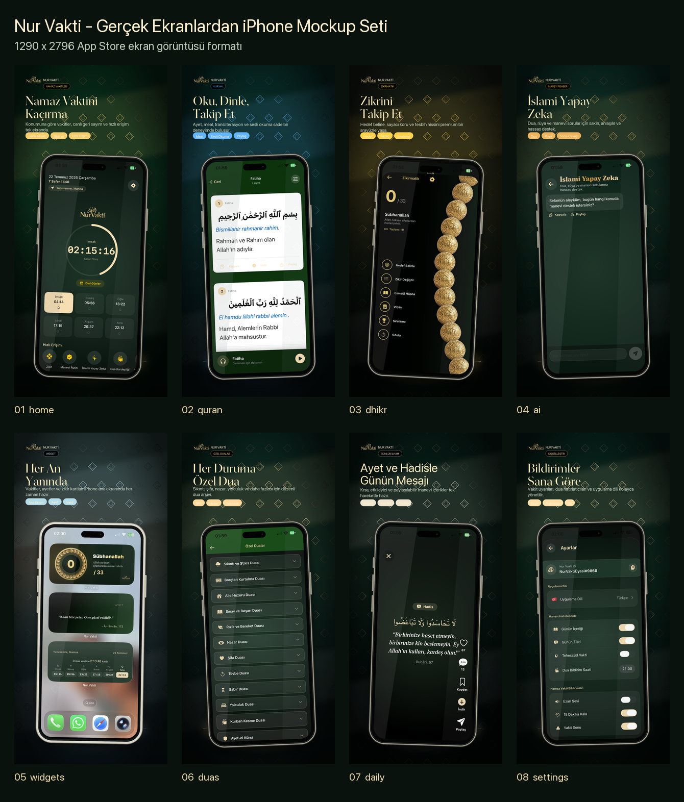
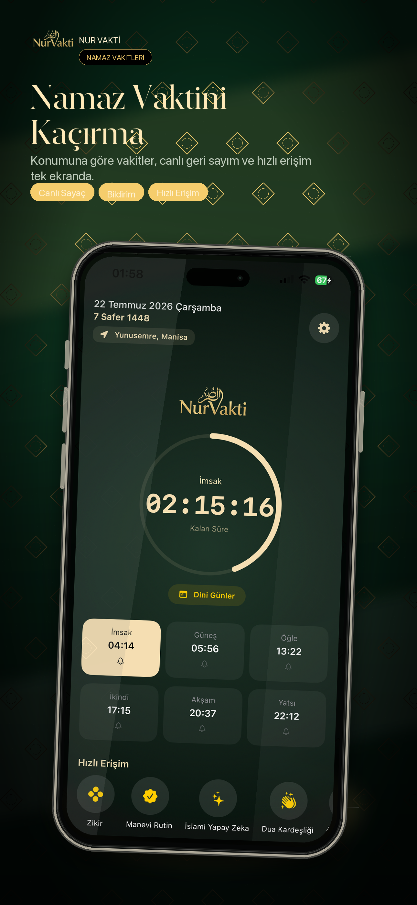
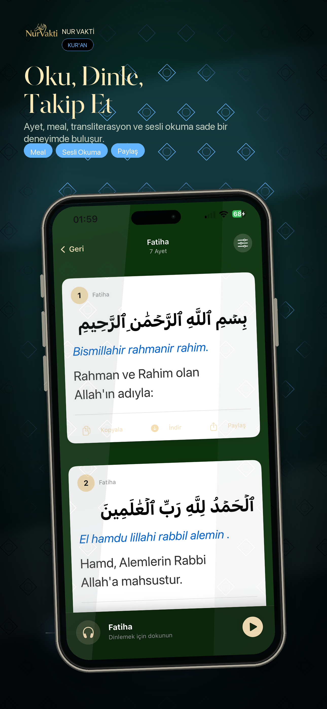
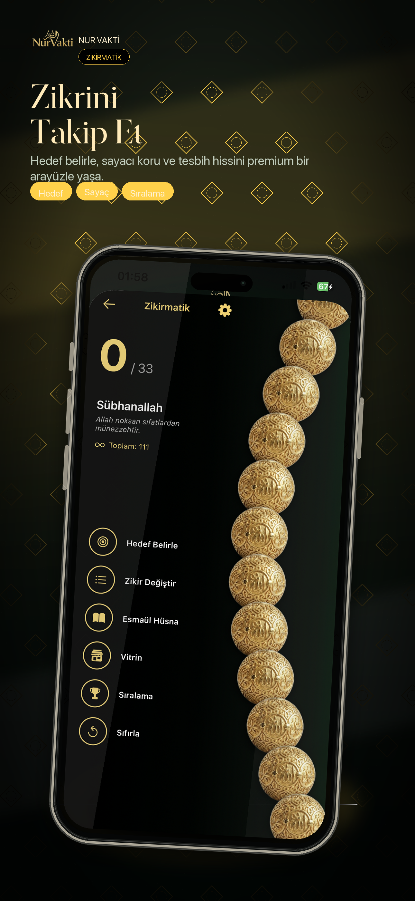
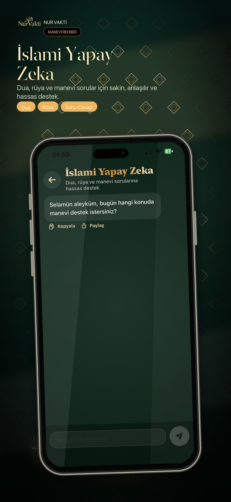
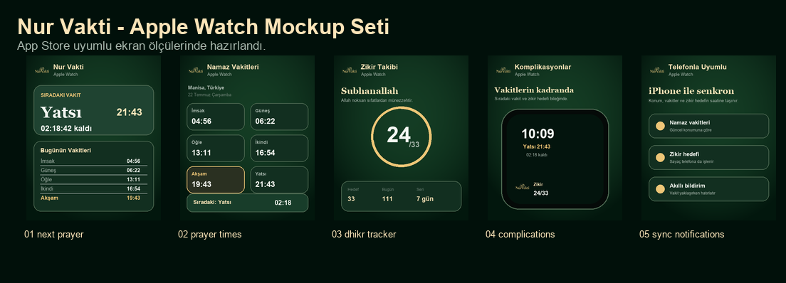

  <a href="README.md">Türkçe</a> · <strong>English</strong>

  <h1>Nur Vakti iOS</h1>
  
<strong>Prayer times, the Quran, dhikr and daily spiritual content on iPhone and Apple Watch.</strong>

  

    
    
    
    
    
  

## Product at a glance

| | |
| --- | --- |
| **Core experience** | The next prayer, personal reminders and daily spiritual content. |
| **Ecosystem** | iPhone, home-screen widgets, Apple Watch and complications. |
| **Content** | Quran, duas, the 99 Names of Allah, religious dates and daily verses. |
| **Personal tracking** | Dhikr goals, missed prayers, zakat and khatm tools. |

## Highlights

- Location- or city-based prayer times with multiple calculation methods
- Customizable adhan, pre-prayer and post-prayer notifications
- Quran with Arabic text, translations, transliteration and recitation
- Dhikr goals, streaks and history with sound and haptics
- Qibla compass, Ramadan timetable, religious dates and personal duas
- Daily verses, hadiths and messages with save and share actions
- In-app AI guide for Islamic topics
- Apple Watch app, complications and cross-device preference sync
- 28 localization folders

## Screens

  
  
  
  

### Apple Watch

The watch app shows the next prayer, the full daily schedule and dhikr goals. Complications provide quick access while preferences synchronize with iPhone.

## Compatibility and links

- iOS 16.6 and later
- watchOS 10 and later
- [App Store](https://apps.apple.com/tr/app/nur-vakti-namaz-i-msakiye/id6758713590?l=tr)
- [nurvakti.app](https://www.nurvakti.app/)

Sources and licences for bundled adhan sounds are documented in [AUDIO_LICENSES.md](AUDIO_LICENSES.md) and [docs/adhan-audio-sources.md](docs/adhan-audio-sources.md).

© 2026 Nur Vakti. All rights reserved.
