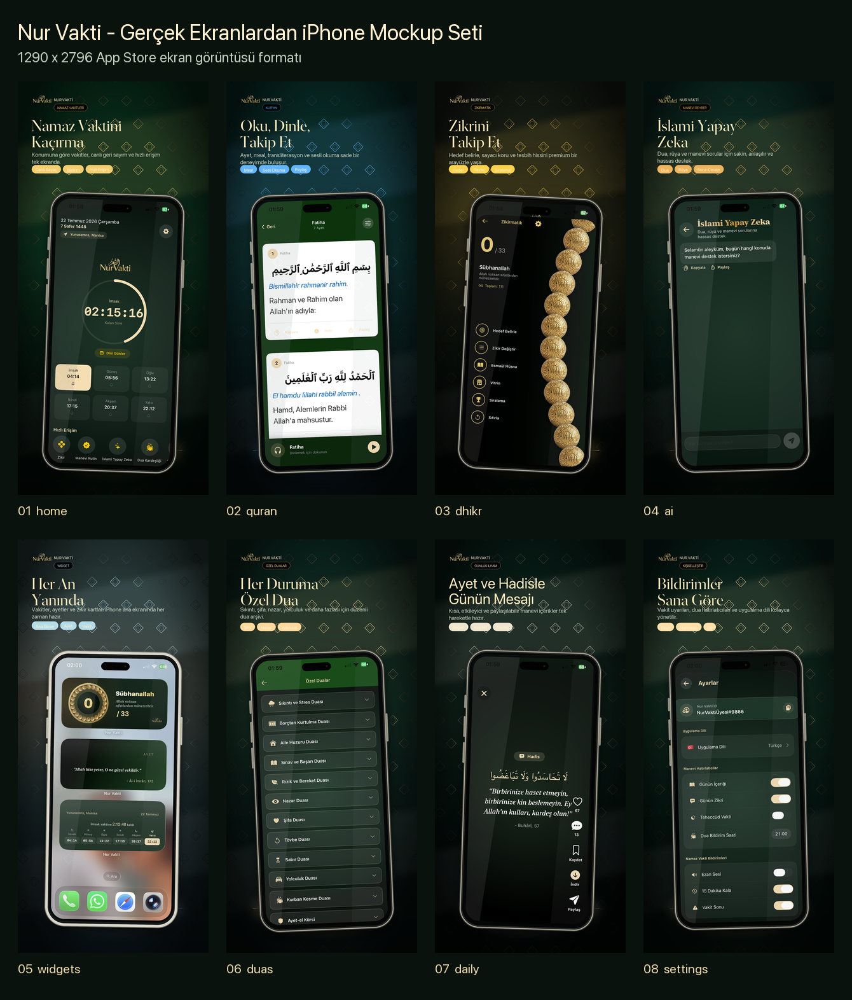
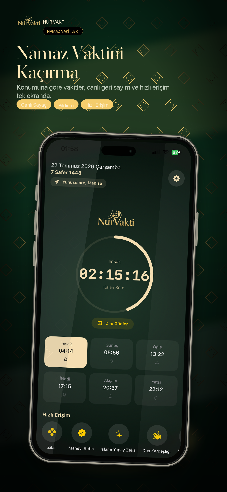
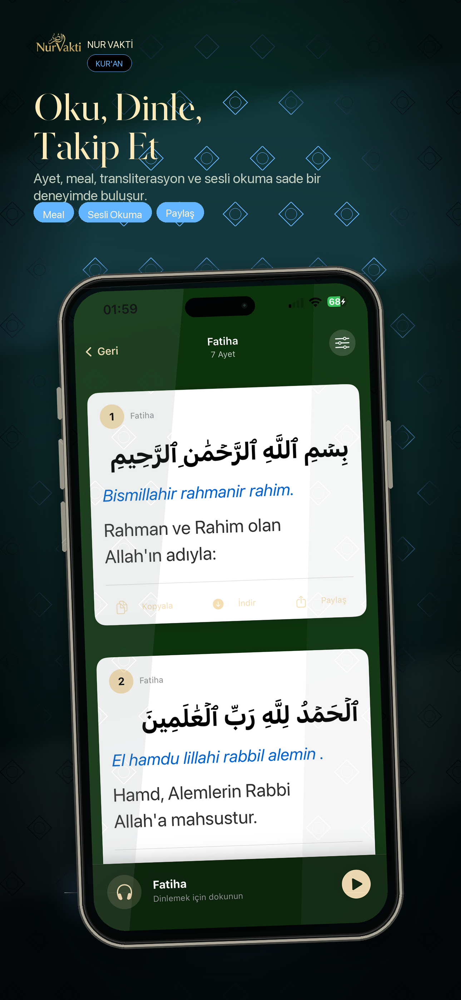
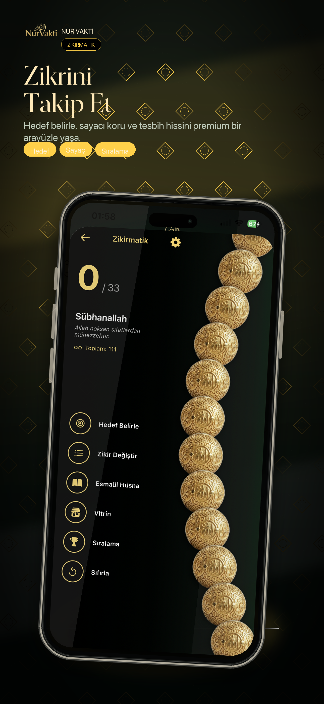
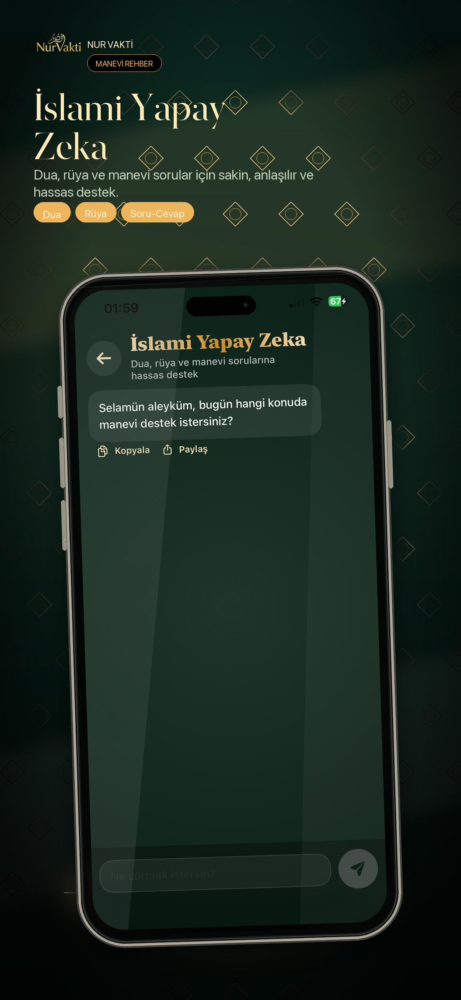
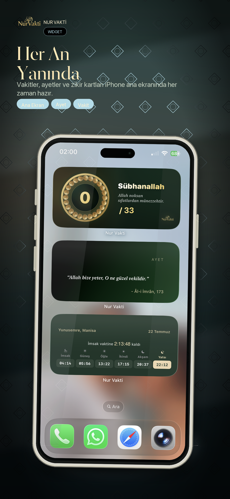
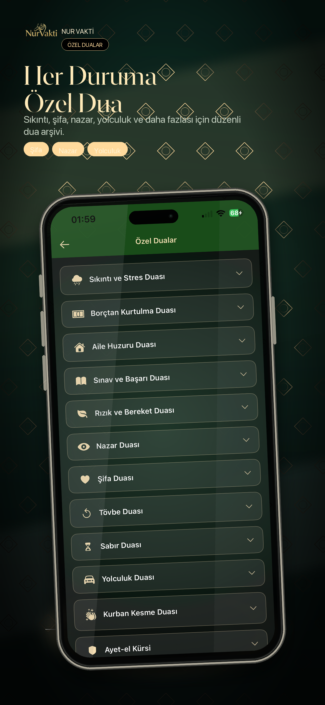
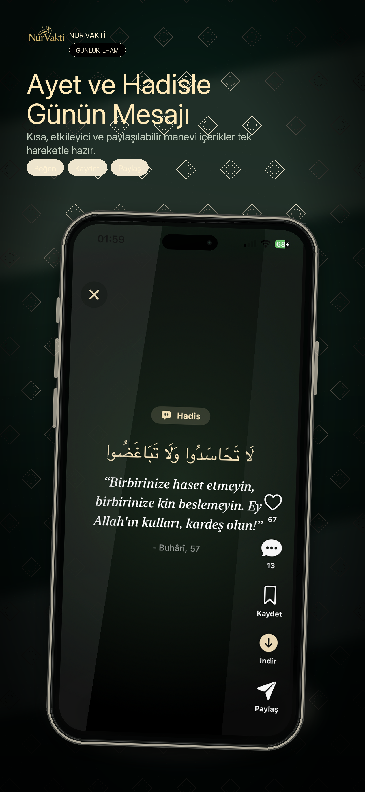
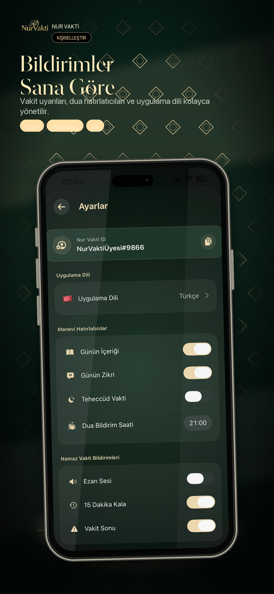
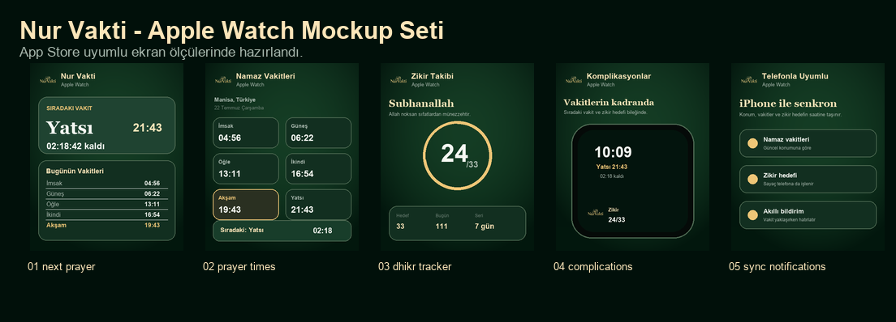

  <a href="#turkce">Türkçe</a> · <a href="README.en.md">English</a>

  <h1>Nur Vakti iOS</h1>
  
<strong>Namaz vakitleri, Kur’an, zikir ve günlük manevi içerikler — iPhone ve Apple Watch’ta.</strong>

  

    
    
    
    
    
  

## Ürün özeti

| | |
| --- | --- |
| **Ana deneyim** | Yaklaşan namaz vakti, kişisel hatırlatmalar ve günlük manevi içerik. |
| **Ekosistem** | iPhone, ana ekran widget’ları, Apple Watch uygulaması ve komplikasyonlar. |
| **İçerik** | Kur’an, dualar, Esmaül Hüsna, dini günler ve günlük ayet/hadis. |
| **Kişisel takip** | Zikir hedefi, kaza namazı, zekât ve hatim araçları. |

## Özellikler

- Konuma veya şehre göre namaz vakitleri ve farklı hesaplama yöntemleri
- Ezan, vakit öncesi ve vakit sonrası için özelleştirilebilir bildirimler
- Arapça metin, meal, Latin harfli okunuş ve sesli Kur’an
- Hedef, seri ve geçmiş takibi sunan zikir sayacı
- Kıble pusulası, imsakiye, dini günler ve özel dualar
- Günün ayeti, hadisi ve mesajları için kaydetme ve paylaşma
- İslami konular için uygulama içi AI rehberi
- Apple Watch, komplikasyonlar ve cihazlar arası tercih senkronizasyonu
- 28 yerelleştirme klasörü

## Ekranlar

  
  
  
  

  
  
  
  

### Apple Watch

Saat uygulaması sıradaki vakti, günlük namaz programını ve zikir hedefini gösterir. Komplikasyonlar hızlı erişim sağlarken tercihler iPhone ile senkronize edilir.

## Uyumluluk ve bağlantılar

- iOS 16.6 ve sonrası
- watchOS 10 ve sonrası
- [App Store](https://apps.apple.com/tr/app/nur-vakti-namaz-i-msakiye/id6758713590?l=tr)
- [nurvakti.app](https://www.nurvakti.app/)

Ezan seslerinin kaynak ve lisans bilgileri [AUDIO_LICENSES.md](AUDIO_LICENSES.md) ve [docs/adhan-audio-sources.md](docs/adhan-audio-sources.md) dosyalarında yer alır.

© 2026 Nur Vakti. Tüm hakları saklıdır.
